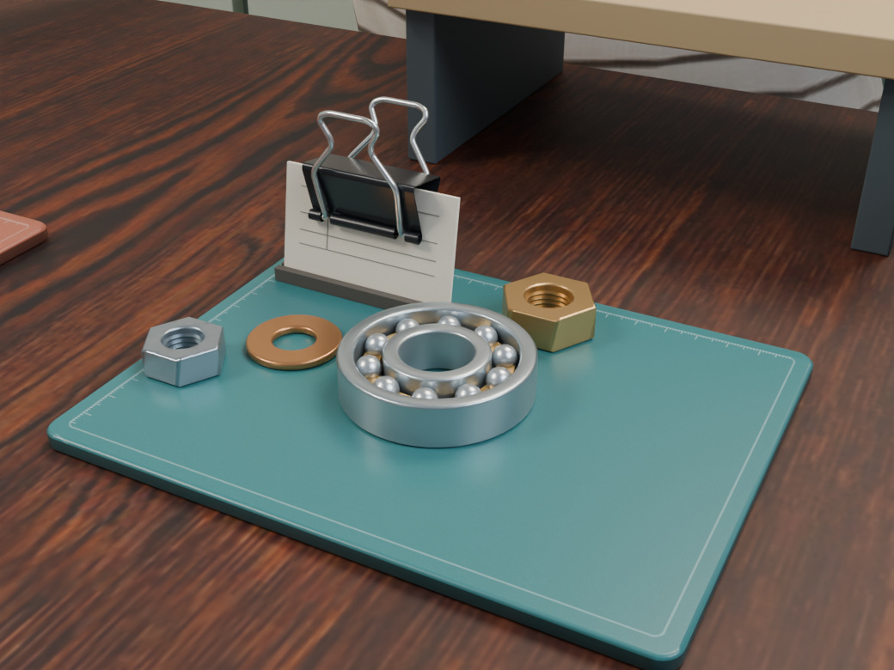

# Franka Preference Experiments

[Open the experiment dashboard](https://xilunzhangrobo.github.io/franka-preference-experiments/)

Robot-eye recordings of ten Astra Medium benchmarks for learning preferences from silent human interaction. The dashboard includes the matched mug-handle pilot, the nine additional seeded transfer runs, and earlier simulator previews.

The new run logs include the instructions, selected actions, simulator measurements, and inferred notes. The robot executes pick-and-place primitives with kinematic grasps. Human cues come from scripted avatar motion.

The dashboard publishes from the root of `main` using GitHub Pages.

## MuJoCo visual experiments

The `mujoco` branch adds ten executable teaching, transfer and scope scenarios. Start with **paused work**. A Panda shelves a work mat whose project ticket carries a black foldback clip. The seated person puts that mat back and can say “Try again.” The opposite mat stays on the bench. A separate sewing-room trial tests whether a fresh decision maker can use the written memory.



[Watch the Cycles recording from the agent camera](docs/media/workshop-cycles-agent.mp4) · [Inspect the same camera view at 1920 × 1440](docs/media/workshop-cycles-agent-2x.jpg) · [View the manipulated objects across all ten scenarios](docs/media/prop-gallery.jpg)

On Linux with EGL or a Mesa EGL implementation, from the repository root:

```bash
uv sync --locked --python 3.13
source .venv/bin/activate
export MUJOCO_GL=egl
franka-prefs assets
franka-prefs record paused-work --out runs/demo --seed 0 --feedback retry --fps 18
```

The recorder uses MuJoCo for motion and Blender Cycles for the agent view, including the teaching video and the images Astra receives. For a fast OpenGL recording, add `--renderer mujoco`. Open `runs/demo/sensor/teach/view.mp4` to see the interaction. Each probe starts with a fresh image. `sensor/` contains camera observations, the task and the speech transcript. `examiner/` contains the answer key, trace, asset fingerprints and final poses. The renderer uses an articulated Menagerie Panda, a Blender-prepared Rocketbox skin with an 80-bone rig, and a scanned wood texture.

| Read or run | Purpose |
| --- | --- |
| [Scenario and overlap map](docs/scenarios.md) | Which Isaac experiments were already published and what these visual probes add |
| [Run a visual experiment](docs/running.md) | Model adapter, cue-based review, written notes, counterfactuals, physical replay and scoring |
| [Two-agent visual study](docs/visual-interaction-study.md) | Run ten isolated Astra pairs, a continuing robot and person, and paired tests of the final note library |
| [Manipulated objects and their audit](docs/object-fidelity.md) | Which geometry changed, what a blinded reader could see, and where clearance was measured |
| [Simulation audit and blinded pilot](docs/development-audit.md) | Failures the reviewers found, measured repairs and what a correct choice establishes |
| [Cycles recording and replay](docs/cycles.md) | Render the agent camera, inspect individual frames and verify a replay against MuJoCo |
| [Experiment lifecycle](docs/experiment-lifecycle.md) | How to preregister, audit, report and compare with hardware |
| [Editable Blender character](assets/human/README.md) | Source, licensing and rebuild instructions |
