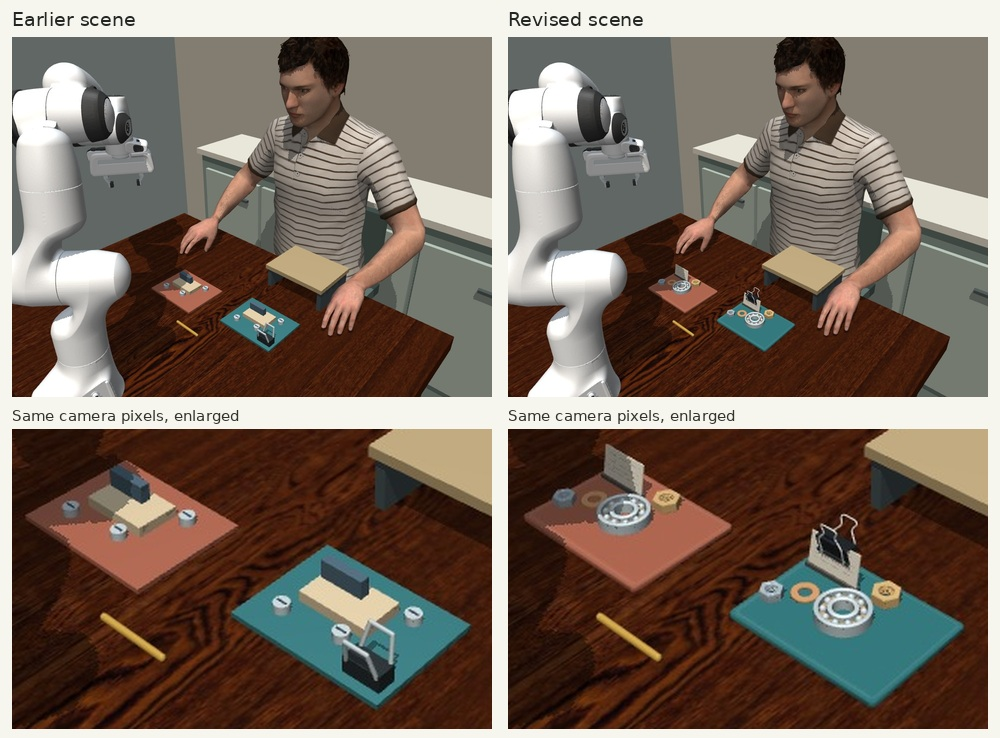

# What changed in the manipulated objects

The original paused-work scene used a dark box and six rods as a binder clip. It stood on a mat with nothing between its jaws. At the resolution of the agent camera, recognizing a dark protrusion was enough to distinguish the two choices. The revision gives that cue a physical interpretation. Both mats carry a paper job ticket in the same shallow holder. A single foldback clip grips the upper edge of one ticket. The robot moves the entire mat and the person can return it with a brief “Try again.”



## What is in the scene

The 41 mm clip has a hollow folded shell, rolled lips and two continuous bent wire handles. The width and black steel and nickel-wire construction follow a manufacturer's catalog. Wire bends, wall thickness, coatings and the card mount were authored for this experiment. No dimensions have been taken from Matt’s physical workbench. The ticket moves with the project. It is an added fixture and the learner could exploit its appearance alongside clip, color or position. [ACC binder clip catalog](https://www.acc.ind.br/en/catalogos/Catalogo_ACC_EN.pdf)

| Scenario | Visible change to the manipulated objects |
| --- | --- |
| Paused work | Radiused work mats with printed scales, threaded hex nuts, a washer with a through-hole, an open ball bearing, wound thread, a folded cloth swatch, and a latching sewing tin. |
| Gift finishing | Layered paper flower, folded tissue, wrapped parcel and an open cardstock box with a separate lid. The lunch-packing exception uses removable lids with catches and portions with visible sandwich layers. |
| Receiving hand | A flashlight with a recessed reflector and ribbed grip, plus a remote with a shaped case and directional pad. |
| Approach side | Open tapered tumbler with a recessed liquid surface, and a folded cloth with edge stripes. |
| Material order | Hollow terracotta pot with a drainage hole and a concave scoop blade attached to a wooden handle. |
| Private storage | Rounded pen pouch with zipper teeth and a pull. |
| Cleaning scent | Paired bottles with molded shoulders, collars, trigger sprayers and product labels. |
| Lighting | Rocker, bezel and screws on an angled weighted switch. |
| Vegetable texture | Branching florets with lobed crowns, tapered bean pods with seed bulges, and a shallow rimmed plate. The two batches share their colors. Doneness is scripted in their shapes. |
| Completion update | Speaker housing with a grille and controls at the source of the spoken update. |

[Inspection gallery covering all ten scenarios](media/prop-gallery.jpg) · [Workshop detail](media/workshop-props.jpg) · [Sewing detail](media/sewing-props.jpg)

## What failed during development

The first visually convincing prototype put the robot’s right finger 5.5 mm into the washer hull during transport. In another reach, the robot crossed the job ticket by 13.1 mm. The returning person’s hand also intersected the ticket. A static render and an audit limited to the table and shelf both missed these failures.

The revised layout reserves a front edge for the robot and an outer corner for the person. The ticket mount faces away from the person's approach. Loose parts vary within patches that leave those routes open. Both mats in a scene use the same mounting convention regardless of clip assignment. A regression removes the clip from one of two otherwise identical mats and requires the remaining rendered geometry and generated textures to match. A second regression casts a ray through the washer bore and another into its metal annulus.

Inspections use two different views. The regular agent camera shows the evidence available to the learner. The close-ups expose defects in the models. One Cycles frame of the person's correction was also rendered from the regular camera and verified against the native teaching stream's state digest. [Recording from the agent camera](media/workshop-agent-correction.mp4) · [Verified correction frame](media/workshop-correction-frame.jpg)

## How to reproduce the checks

From the repository root, use the locked simulation environment and installed Panda assets described in the README. These are development seeds.

```bash
export MUJOCO_GL=egl OPENBLAS_NUM_THREADS=1
python -m unittest discover -s tests -v
franka-prefs audit --seeds 0 1 --out runs/props-qa
franka-prefs record paused-work --seed 0 --feedback retry --fps 18 --out runs/props-record
python tools/inspect_props.py --seed 0 --out runs/props-gallery
python -m visual_prefs.prop_clearance --seeds 0 1 2 5 --fps 24 --control
```

The main audit exercises both actions in teaching, transfer and exception for all ten families. Paused-work additionally tests simulated transport with movable cargo envelopes, visibility, avatar motion and distances from the moving Panda and skinned hands to the mat contents. It includes a deliberate obstruction and applies the recorder's phase-specific layout offsets. The standalone clearance command above checks the same unshifted layouts across phases. Add `--bundle-seeds` to use the recorder offsets there as well.

For the workshop close-up use the Blender environment in [Cycles replay](cycles.md) with `--phase teach --seed 0 --frame 0 --detail-at-prop near --size 1040 780 --samples 64`. For a state-verified correction frame use `--phase teach --seed 0 --fps 18 --frame 96 --camera agent --size 960 720 --samples 48 --verify-state runs/props-record/examiner/teach.json`. Pass a fresh output directory with `--out` for each invocation.

## What the evidence supports

The geometry shows a particular physical interpretation of a correction. The clip stays closed, the hands follow scripted trajectories, and the standard recording moves the mat and contents kinematically. A separate gravity and contact model uses simplified collision envelopes for sliding and settling. Hardware grasp forces, a deforming clip, fabric dynamics and real-room lighting have not been measured. The clip can occupy fewer than 100 pixels in a transfer image at 480 × 360. Material close-ups alone cannot establish that a learner has inferred the person's preference.

The earlier Astra preference-learning scores belong to the [archived original stimuli](review-record/README.md). Measurements and visual reader observations for the revised assets are in the [prop audit record](prop-audit/README.md).
